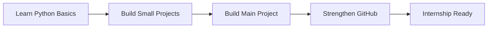

## Hi there 👋

<!--
**anamikagupta2408/anamikagupta2408** is a ✨ _special_ ✨ repository because its `README.md` (this file) appears on your GitHub profile.

Here are some ideas to get you started:

- 🔭 I’m currently working on ...
- 🌱 I’m currently learning ...
- 👯 I’m looking to collaborate on ...
- 🤔 I’m looking for help with ...
- 💬 Ask me about ...
- 📫 How to reach me: ...
- 😄 Pronouns: ...
- ⚡ Fun fact: ...
-->

 

<!-- CHANGE THIS: replace youremail@gmail.com and your-linkedin-id -->

---

## 👋 About Me
I'm a 3rd-year B.Tech CSE (AI/ML) student with knowledge of Data Structures and Algorithms, software development, and
Machine Learning who enjoys learning by building real projects.
I'm seeking opportunities to apply technical skills, build scalable applications, and solve real
world problems through innovative software solutions.

**Currently learning:**
- 🐍 Python
- 📈 Data Science & Analytics
- 🧠 Problem solving
- 🤖 Machine Learning
- 🔎RAG & Semantic Search
- 🛠️Agentic AI &LLM

---

| Focus | Current Direction |
|---|---|
| 🎓 Education | B.Tech, Computer Science, 3rd Year |
| 🧰 Learning | Python, Machine Learning,GenAI|
| 🎯 Goal | Internship-ready with a strong project |

---

## 📊 GitHub Activity

---

## 🛠️ Tech Stack

  

## 🎯 Current Mission

---

## 🚀 Projects

<b>OPEN PROJECT TABLE</b> (Click to expand)

<!-- CHANGE THIS: replace the row below with your real project -->
| Project | What it does | Tech |
|---|---|---|
| My First Project | Short one-line description | Python |

---

⭐ Thanks for visiting my profile!

